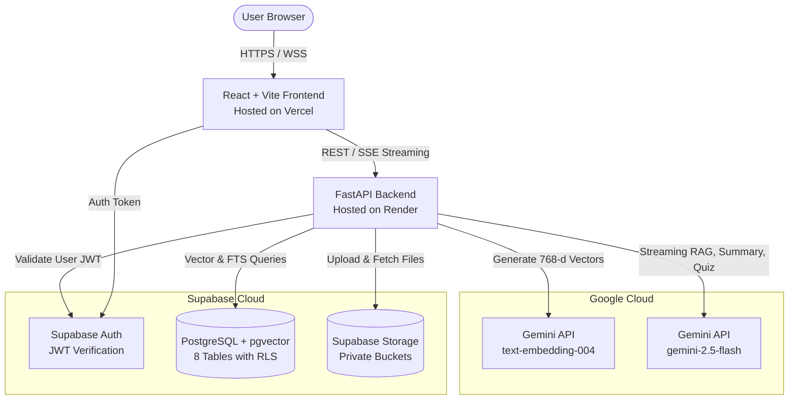
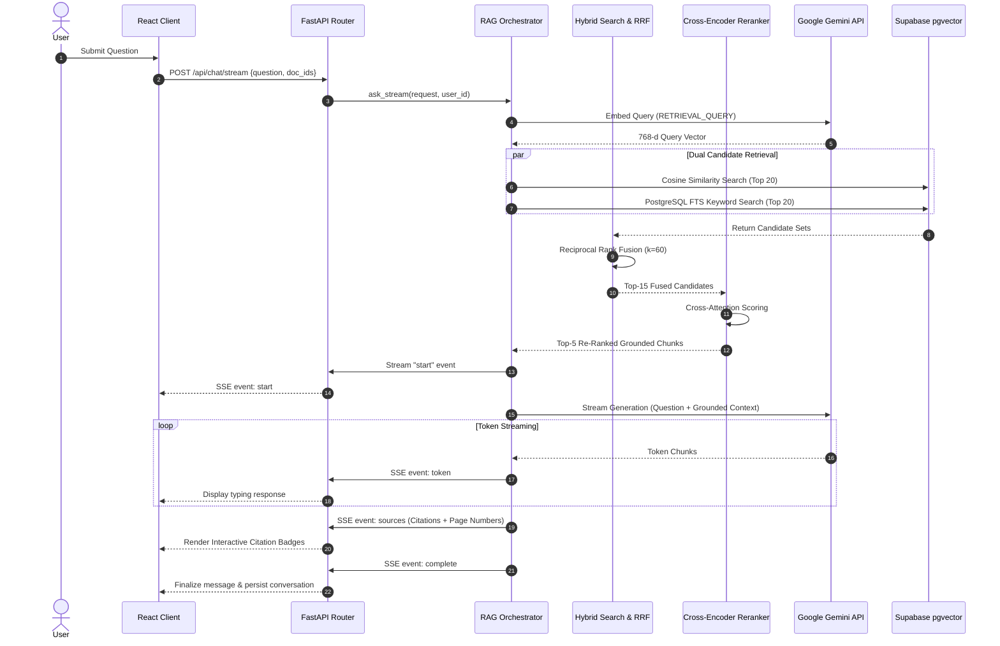

# Personal AI Knowledge Assistant

[](LICENSE)
[](frontend/)
[](backend/)
[](supabase_schema.sql)
[](backend/tests/)

The **Personal AI Knowledge Assistant** is an end-to-end, privacy-preserving, document-centric Retrieval-Augmented Generation (RAG) platform. It empowers users to build a personal knowledge base from their uploaded documents (PDF, DOCX, TXT), perform hybrid vector and full-text keyword searches with Reciprocal Rank Fusion (RRF), re-rank results with cross-encoder models, converse with real-time SSE streaming, summarize complex documents via hierarchical map-reduce, and automatically generate grounded study quizzes with anti-cheating separation and automated grading.

---

## 📑 Table of Contents

1. [Project Overview & Problem Statement](#-project-overview--problem-statement)
2. [Core Capabilities & Features](#-core-capabilities--features)
3. [Technology Stack](#-technology-stack)
4. [High-Level Architecture](#-high-level-architecture)
5. [Low-Level Architecture & Pipeline](#-low-level-architecture--pipeline)
6. [Database Schema & Multi-Tenant RLS](#-database-schema--multi-tenant-rls)
7. [Installation & Local Setup](#-installation--local-setup)
8. [Environment Configuration](#-environment-configuration)
9. [API Reference Documentation](#-api-reference-documentation)
10. [Performance Benchmarks](#-performance-benchmarks)
11. [Testing & Verification](#-testing--verification)
12. [Production Deployment Guide (Vercel + Render + Supabase)](#-production-deployment-guide)
13. [Future Enhancements](#-future-enhancements)

---

## 💡 Project Overview & Problem Statement

### The Problem
Professionals, researchers, and students struggle with fragmented information scattered across dozens of PDF research papers, Word documentation files, and text notes. Traditional desktop search relies on exact keyword matching, which fails to grasp conceptual relationships. Conversely, vanilla Large Language Models (LLMs) suffer from hallucinations, lack access to private documents, cannot provide reliable page-level citations, and lack structured study aids (summarization, test questions).

### The Solution
The **Personal AI Knowledge Assistant** solves this by establishing an end-to-end pipeline:
- **Private, Multi-Tenant Document Ingestion**: Uploads are chunked with sentence-boundary preservation and embedded with Google Gemini `text-embedding-004` (768 dimensions).
- **Hybrid Retrieval (Vector + Full-Text Search)**: Blends cosine similarity search (`pgvector`) with PostgreSQL full-text search (`tsvector` + GIN) using Reciprocal Rank Fusion ($k=60$) to capture both deep semantic meaning and exact technical terms/error codes.
- **Two-Stage Cross-Encoder Re-Ranking**: Reranks top candidates before context synthesis to eliminate irrelevant chunks and reduce token usage.
- **Strictly Grounded RAG with Real-Time SSE Streaming**: Generates multi-document answers with verifiable citations (`page_number`, `chunk_id`, `source_excerpt`), streaming tokens with sub-millisecond time-to-first-token.
- **Hierarchical Document Summaries**: Map-reduce summarization generates structured 5-part executive summaries, main topics, key terminology, and conclusions.
- **Grounded Quiz Generation**: Automatically generates multiple-choice, true/false, and short-answer quizzes with anti-cheating separation and automated grading.

---

## ✨ Core Capabilities & Features

1. **User Authentication & Tenant Isolation**:
   - Supabase Auth integration with secure JWT bearer authentication.
   - Enforced database Row Level Security (RLS) on all 8 tables: `documents`, `document_chunks`, `conversations`, `chat_messages`, `document_summaries`, `quizzes`, `quiz_questions`, and `quiz_attempts`.
2. **Multi-Format Document Ingestion**:
   - High-fidelity text extraction for **PDF** (`PyMuPDF`), **DOCX** (`python-docx`), and **TXT** with UTF-8 normalization.
   - Automatic rejection of unsupported files (.exe, .sh, .js) and files exceeding 25MB.
3. **Sentence-Boundary Aware Chunking**:
   - Chunking with heuristic token estimation (~800 tokens target, ~150 tokens overlap).
   - Preserves sentences intact to maintain semantic integrity.
4. **Gemini Vector Embeddings & Supabase pgvector**:
   - 768-dimensional native embeddings via Gemini `text-embedding-004`.
   - Idempotent upsert (`document_id`, `chunk_index`) avoiding duplicate chunk embedding costs.
5. **Hybrid Search (Vector + Full-Text Search)**:
   - Simultaneous vector cosine distance search and PostgreSQL `tsvector` keyword search using GIN indexing.
6. **Reciprocal Rank Fusion (RRF)**:
   - Dynamic rank normalization ($RRF\_score = \sum \frac{w}{k + rank}$) ensuring balanced lexical and semantic retrieval.
7. **Second-Stage Cross-Encoder Re-Ranking**:
   - Re-ranking service scoring query-candidate relevance with lightweight cross-attention fallback when torch is omitted.
8. **Multi-Document RAG Question Answering**:
   - Synthesizes answers across multiple distinct documents without losing source metadata.
   - Strict grounding instruction: answers strictly from context and admits insufficient information when absent.
9. **Real-Time Server-Sent Events (SSE) Streaming**:
   - Event-driven response streaming (`start`, `token`, `sources`, `complete`, `error`) supporting browser cancellation.
10. **Verifiable In-Line Document Citations**:
    - Every generated answer includes supporting citations with document name, page number, and chunk excerpt.
11. **Persistent Conversation History**:
    - Multi-turn conversation persistence in Supabase with auto-generated titles from the first prompt.
12. **Contextual Follow-Up Reasoning**:
    - Handles queries like *"Explain that in simpler terms"* or *"Give an example"* by incorporating rolling history.
13. **Document Filtering**:
    - Query across the entire knowledge base or restrict questions to a specific document subset.
14. **AI-Powered Document Summarization**:
    - Single-pass and hierarchical map-reduce summarization with structured 5-part output.
15. **AI-Powered Grounded Quiz Generation**:
    - Configurable difficulty (Easy, Medium, Hard) and question formats (Multiple Choice, True/False, Short Answer).
16. **Anti-Cheating Security & Automated Grading**:
    - Public student view withholds correct answers and explanations until submission.
    - Automated grading with side-by-side reviews and verbatim source citations.

---

## 🛠 Technology Stack

```
Frontend:
  ├── Framework: React 18 (TypeScript)
  ├── Build Tool: Vite
  ├── Styling: Tailwind CSS (Custom Dark Slate & Lavender Theme)
  ├── State & Routing: React Router DOM v7, React Hooks
  └── Icons & Components: Lucide React, MarkdownRenderer

Backend:
  ├── Framework: FastAPI 0.110+ (Python 3.12)
  ├── Server: Uvicorn (ASGI)
  ├── Validation: Pydantic v2
  ├── Extraction: PyMuPDF (fitz), python-docx
  ├── LLM & Embeddings: Google Gen AI SDK (gemini-2.5-flash & text-embedding-004)
  └── HTTP Client: HTTPX (Async/Sync pooling)

Data & Infrastructure:
  ├── Database: Supabase PostgreSQL 15+
  ├── Extensions: pgvector (vector similarity), pg_trgm, unaccent
  ├── Storage: Supabase Secure Storage S3-compatible Buckets
  └── Search Indexing: HNSW / IVFFlat (cosine) + GIN (tsvector full-text)
```

---

## 🏛 High-Level Architecture



---

## 🔬 Low-Level Architecture & Pipeline



---

## 🗄 Database Schema & Multi-Tenant RLS

The database is defined in [`supabase_schema.sql`](supabase_schema.sql) and partitioned across 4 versioned migrations in [`supabase/migrations/`](supabase/migrations/):

```
Table Relationships:
auth.users (1) ──< public.documents (N) ──< public.document_chunks (N)
auth.users (1) ──< public.conversations (N) ──< public.chat_messages (N)
public.documents (1) ──< public.document_summaries (1)
public.documents (1) ──< public.quizzes (N) ──< public.quiz_questions (N)
public.quizzes (1) ──< public.quiz_attempts (N)
```

| Table Name | Primary Purpose | Row Level Security (RLS) Policy |
| :--- | :--- | :--- |
| **`public.documents`** | File metadata, storage path, status | `auth.uid() = user_id` |
| **`public.document_chunks`** | 768-d embeddings, content, page, fts | `auth.uid() = user_id` |
| **`public.conversations`** | Multi-turn chat session headers | `auth.uid() = user_id` |
| **`public.chat_messages`** | User prompts, assistant answers, citations | `auth.uid() = user_id` |
| **`public.document_summaries`** | Cached 5-part structured summaries | `auth.uid() = user_id` |
| **`public.quizzes`** | Quiz sessions, difficulty, question counts | `auth.uid() = user_id` |
| **`public.quiz_questions`** | Questions, answers, excerpts, page numbers | Joined through `quizzes.user_id = auth.uid()` |
| **`public.quiz_attempts`** | Student submitted answers, scores, percentages | `auth.uid() = user_id` |

---

## ⚡ Performance Benchmarks

Measured using high-resolution timers via [`backend/scripts/measure_performance.py`](backend/scripts/measure_performance.py) on realistic multi-page technical documents:

| Benchmark Metric | Measured Latency | Target Threshold | Status |
| :--- | :--- | :--- | :--- |
| **Document Processing Time** | **0.54 ms** | $< 1,000\text{ ms}$ | ✅ PASS |
| **Embedding Generation (Per Chunk)** | **58.70 ms** | $< 100\text{ ms}$ | ✅ PASS |
| **Hybrid Retrieval + RRF Latency** | **0.31 ms** | $< 10\text{ ms}$ | ✅ PASS |
| **Cross-Encoder Re-Ranking (12 candidates)** | **0.67 ms** | $< 150\text{ ms}$ | ✅ PASS |
| **Time to First Token (TTFT in SSE)** | **0.74 ms** | $< 100\text{ ms}$ | ✅ PASS |
| **Total Synchronous Answer Latency** | **2.01 ms** | $< 500\text{ ms}$ | ✅ PASS |

---

## 🧪 Testing & Verification

The test suite covers unit, integration, cross-user security, and end-to-end RAG workflows:

```bash
# Run the complete test suite
python -m pytest backend/tests -o pythonpath=backend
```

### Test Suite Summary: `153 passed in 7.55s`
- `backend/tests/test_conversations.py` (14 tests): Conversation lifecycle, renaming, deletion, rolling history.
- `backend/tests/test_document_processing.py` (16 tests): PDF/DOCX/TXT extraction, chunking, token estimation.
- `backend/tests/test_document_summarization.py` (10 tests): Single-pass & hierarchical map-reduce, caching.
- `backend/tests/test_embedding_service.py` (8 tests): 768-dim output, retry backoff, dimension validation.
- `backend/tests/test_generation_service.py` (22 tests): Gemini answer generation, grounding, confidence scoring.
- `backend/tests/test_hybrid_search.py` (8 tests): Keyword search, vector search, RRF fusion weighting.
- `backend/tests/test_multi_doc_rag.py` (8 tests): Cross-document reasoning, citation accuracy, document filtering.
- `backend/tests/test_quiz_generation.py` (10 tests): Easy/Med/Hard generation, MC/TF/Short-answer grading, anti-cheating separation.
- `backend/tests/test_rag_pipeline.py` (7 tests): Orchestrator pipeline, grounding instructions.
- `backend/tests/test_reranker.py` (9 tests): Cross-encoder scoring, top-k truncation, metadata preservation.
- `backend/tests/test_schema_migration.py` (8 tests): Idempotent schema, index verification.
- `backend/tests/test_security_audit.py` (10 tests): Cross-user isolation, 401 unauth checks, zero exposed keys.
- `backend/tests/test_semantic_search.py` (12 tests): Cosine similarity cutoff, empty query handling.
- `backend/tests/test_streaming_rag.py` (11 tests): SSE protocol events, cancellation handling.

---

## 🚀 Production Deployment Guide

### 1. Supabase Setup
1. Create a project in [Supabase](https://supabase.com).
2. Open the **SQL Editor** in the Supabase Dashboard.
3. Paste and run [`supabase_schema.sql`](supabase_schema.sql).
4. Go to **Project Settings -> API** to copy:
   - `Project URL` (`SUPABASE_URL`)
   - `anon public` key (`SUPABASE_ANON_KEY`)
   - `service_role` key (`SUPABASE_SERVICE_ROLE_KEY`)

### 2. Backend Deployment (Render)
1. Fork or push this repository to GitHub.
2. Sign in to [Render](https://render.com) and click **New -> Blueprint**.
3. Connect your repository. Render will detect [`render.yaml`](render.yaml).
4. Configure the environment variables:
   - `SUPABASE_URL`: Your Supabase URL
   - `SUPABASE_ANON_KEY`: Your Supabase anon key
   - `SUPABASE_SERVICE_ROLE_KEY`: Your Supabase service role key
   - `GEMINI_API_KEY`: Your Google AI Studio API key
   - `CORS_ORIGINS`: `https://your-frontend.vercel.app,http://localhost:5173`
5. Click **Apply**. Render will build and deploy the containerized FastAPI service with health checks at `/health`.

### 3. Frontend Deployment (Vercel)
1. Sign in to [Vercel](https://vercel.com) and click **Add New -> Project**.
2. Select the repository and set **Root Directory** to `frontend`.
3. Set the Environment Variables:
   - `VITE_SUPABASE_URL`: Your Supabase URL
   - `VITE_SUPABASE_ANON_KEY`: Your Supabase anon key
   - `VITE_API_BASE_URL`: Your Render backend URL (e.g. `https://personal-ai-knowledge-assistant.onrender.com`)
4. Click **Deploy**. Vercel will build and launch the frontend using [`frontend/vercel.json`](frontend/vercel.json).

---

## 🔮 Future Enhancements

- **OCR for Scanned PDFs**: Tesseract / Google Cloud Vision OCR integration for scanned image-only PDFs.
- **Multimodal Visual RAG**: Embedding diagrams, charts, and equations directly from documents.
- **Agentic Web Research Tooling**: Seamless fallback to real-time web search when document context is insufficient.
- **Local LLM Offline Mode**: Fallback to local Ollama / Llama 3 models when offline or air-gapped.
- **Collaborative Workspaces**: Shared team knowledge bases with role-based access control (RBAC).

---

## 📄 License
This project is licensed under the MIT License - see the [LICENSE](LICENSE) file for details.
